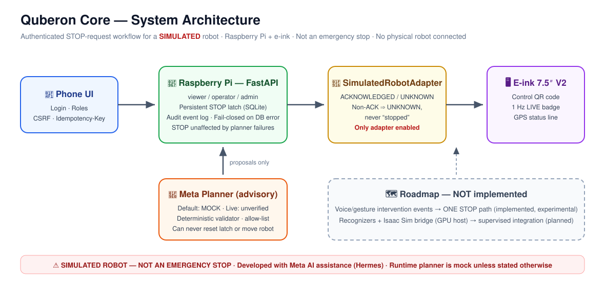
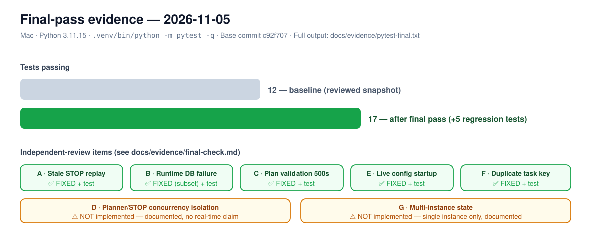

# Quberon Robot Interface (quberon-core)


-dea584)

-ea580c)


Authenticated mobile web prototype for a **simulated** robot STOP-request workflow on a Raspberry Pi with an e-ink display. It is **not** a safety-rated emergency stop and does **not** control physical robot hardware. Only `SimulatedRobotAdapter` is enabled.





## Current status (2026-11-05)

| Capability | Status |
|---|---|
| Public code, app + simulator + scripts + tests | ✅ In this repo |
| Physical Pi + Waveshare 7.5" V2 e-ink (QR / LIVE badge) | ✅ Working (project records, TEST-RESULTS rows 22/29) |
| Authenticated STOP (viewer/operator/admin, CSRF, persistent latch, audit log, simulator ACK) | ✅ Implemented against the **simulator** |
| Physical humanoid control / certified e-stop | ❌ Not implemented, no such claim |
| Phone onboarding (private CA + local AP) | ⚠️ Works with certificate install; not zero-setup, not claimed as frictionless |
| Runtime Meta planning | ⚠️ Mock by default; live adapter exists in code, **live inference not verified** (see `docs/evidence/meta-live.md`) |
| Meta use in development | ✅ Development assistance via Hermes — separate from runtime claims (see `docs/BUILT-DURING-HACKATHON.md`) |
| Cellular (Tele2 EC25) | ✅ Project-recorded HTTP 200 data test (row 28); no failover/continuous claim |
| GNSS | ⚠️ Reader present, NO_FIX indoors, no RTK/accuracy claim |
| Voice / gesture interventions | 🧪 Deterministic recognizers implemented for final transcript observations and normalized 21-point open-palm frames; authenticated STOP-only API, **no microphone/camera capture or physical control** (`docs/INTERVENTION-INPUTS.md`) |
| Isaac Sim | 🧪 Versioned bridge contract + deterministic local transport + fail-closed adapter implemented; Isaac Sim itself not installed/run and adapter not runtime-enabled (`docs/ISAAC-SIM-INTEGRATION.md`) |
| Frontier Phase 1 research | 🧪 Provenance-first humanoid registry scaffold: 6 schemas, 25 unverified seed candidates, stdlib validator, legal + voice/gesture-STOP roadmaps (`research/humanoids/`, `docs/frontier-phase1/`) — no verified companies, no universe-size claim, no physical control |
| Rust secure core (Increment 2) | 🧪 Implemented + tested: Ed25519-signed, scope-pinned, STOP-only envelope (Increment 1) plus epoch binding, key validity/revocation scaffolding, external audit anchor with rollback detection, fault-injection + SQLite write-failure tests, audit-capacity fail-closed, production/development key-custody modes, STOP-isolated rate limiting; `execute_stop` requests a Rust ACCEPTED decision — if the core is unavailable an authenticated simulation STOP still executes UNSIGNED (audit `UNSIGNED/core_unavailable`), a reachable core rejection fails closed (no adapter call, latch retained, UNKNOWN, HTTP 503), and reset/task remain blocked without signed core availability (`docs/SECURE-CORE.md`). **SIMULATION ONLY, STOP AUTHORIZATION ONLY, NO PHYSICAL CONTROL, NOT A SAFETY-RATED E-STOP.** Not externally reviewed, audited, or certified; no HSM, secure OTA, or SLSA provenance claim |

## 🌌 Pushing the Frontier — Building for Superintelligence

**The model proposes; deterministic law disposes.** quberon-core is a governance layer for increasingly capable AI: untrusted planners and multimodal signals (voice transcripts, gesture fixtures, future Isaac Sim bridges) may *propose*, but only authenticated, allow-listed, idempotent, audit-logged services may *act* — and a human can always intervene. Full thesis: [`docs/FRONTIER.md`](docs/FRONTIER.md).

## Run locally

Quickstart (exact commands, from a clean clone). The same commands work
with and without Rust; the difference is only whether `make setup`
builds the secure-core CLI:

With Rust (cargo on PATH — signed secure-core attestation available):

```sh
make setup
make test
make core
cargo test --workspace
make demo
```

Without Rust (no cargo — STOP runs with unsigned attestation; reset and
simulated tasks remain blocked; see `docs/SECURE-CORE.md`,
"Which direction does this fail?"):

```sh
make setup
make test
make demo
```

`make setup` creates `.venv` (preferring `python3.11` when available,
falling back to `python3`; Python 3.11 is the documented version),
installs `requirements.txt`, and builds
the Rust CLI when cargo is present. Without cargo it prints exactly:

```text
secure core not built - STOP will run with unsigned attestation; see docs/SECURE-CORE.md
```

`make test` runs the Python suite (`.venv/bin/python -m pytest -q`).
The suite is green in both modes: Rust-dependent reset/task tests are
skipped when the CLI is not built, and the degraded unsigned-STOP path
is exercised in both modes. Verified counts and raw output for both
modes are recorded in `docs/evidence/lane-a-p0/`. A Mac test pass is
not a Pi or Isaac-host test pass.

Latest verified run (2026-11-05, local Mac, Increment 2 on main): **44 passed** Python (3.11, project `.venv`), **17 passed** Rust (14 core unit/property + 3 CLI integration, `cargo test --workspace --all-features`), `cargo fmt --check` and `cargo clippy --workspace --all-targets --all-features -- -D warnings` clean, `cargo audit` and `cargo deny check` ok, SBOM verified (98 components). Fuzz smoke: **not run** (cargo-fuzz unavailable, exit 77). Lane A re-verification after the rebase is recorded in `docs/evidence/lane-a-p0/SUMMARY.md`. A Mac test pass is not a Pi or Isaac-host test pass.

Rust secure core details: the Python client uses the built CLI at
`target/debug/quberon-secure-core-cli` (or `target/release/...`, or
`$QUBERON_SECURE_CORE_BIN`). See `docs/SECURE-CORE.md`.

## Deploy (from Mac, preserves Ethernet SSH at 10.77.0.2)

```sh
DRY_RUN=1 scripts/deploy_pi.sh
scripts/deploy_pi.sh
scripts/healthcheck.sh https://10.77.0.2:8443 /etc/quberon-robot-interface/ca.crt  # run on Pi, or copy the public CA cert to the Mac first
```

Demo passwords are never stored in this repo (external secrets file, mode 600).

## Known limitations (honest list)

- Single process / single active instance only (review item G, documented): the in-memory latch cache is not multi-instance safe.
- Planner concurrency is capped by its own limiter (review item D, fixed): a saturated planner returns `busy` and cannot starve STOP. This is best-effort isolation, not a real-time guarantee.
- Runtime DB failure now fails closed (503, latch held in memory, `persistence_ok=false`), but authentication also depends on the DB — this is not an always-available emergency-stop path.
- Software latency figures in project records are not physical stop times. The e-ink LIVE badge proves display refresh, not robot-connection freshness.

Historical notes live in `MORNING-HANDOFF.md`, `BLOCKERS.md`, `DECISIONS.md`, `TEST-RESULTS.md` — dated snapshots, superseded by the table above where they conflict.
